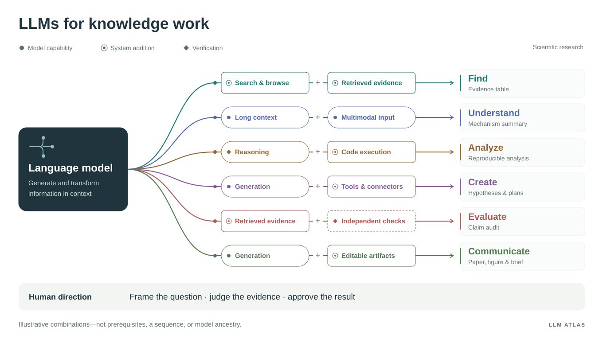

# LLM Atlas — LLMs for knowledge work

An interactive guide to what language models contribute to knowledge work, what the surrounding system adds, and how people remain in control.

The new default viewer is **[`docs/index.html`](docs/index.html)**. Download that one file and open it in a modern browser, or serve the repository locally:

```bash
python -m http.server --directory docs 8000
```

Then open `http://localhost:8000`. The atlas itself has no runtime network dependencies, external fonts, JavaScript packages, API keys or build step. Following source and repository links requires internet access.



## Three views

| View | Purpose |
| --- | --- |
| **Capability map** | Connect a language model to finding, understanding, analyzing, creating, evaluating and communicating. Distinguish model capabilities, system additions and verification. |
| **Milestones** | Explore 16 source-linked historical anchors, newest first, grouped by contribution rather than undocumented ancestry. Filter by activity or contribution type and search the selection. |
| **Working patterns** | Compare completion, conversation, fixed workflows, agents and multi-agent systems by who chooses the next step—not by an assumed maturity ranking. |

The capability map offers scientific-research and general knowledge-work examples. Selecting a branch explains the question, potential work product and checks that remain the person's responsibility. Capabilities and historical milestones open source-linked detail panels.

Use **Present** (or `F`; `Escape` to exit) for a decluttered view. **SVG** exports an editable vector diagram with source metadata; **PNG** exports the current diagram at twice its native resolution. The map and working-pattern views use a 16:9 canvas. The interface supports keyboard navigation, shareable URL-fragment state and contained horizontal scrolling on small screens.

## Scope and evidence

This is a conceptual atlas, not a literal phylogeny, model leaderboard or current product catalogue. The selected chronology covers **2017–September 2025**. Primary-source links and dates were reviewed on **14 October 2026**; that review date does not extend the chronology.

Each milestone identifies whether its date refers to a paper submission, announcement or engineering publication. Models, methods, products, protocols and systems are separate contribution types. No unverified influence edges from the original datasets were imported.

The six activities overlap. Their capability pairings and example questions are **editorial illustrations, not prerequisites or measured task-performance claims**. A retrieved citation, more inference computation, or a second agent is not automatically independent verification. Read the limitations in each detail panel and the **Sources & scope** dialog.

## Maintain and test

The single source of truth is the JSON block with `id="atlas-data"` in `docs/index.html`. Data, presentation styles and rendering code are embedded so the downloadable viewer works on its own. The current map layout expects six activities, two example ingredients per activity and five working patterns; update the layout and tests together when changing those counts.

The validator and data tests use only the Python standard library:

```bash
python app/validate_atlas.py
python -m unittest discover -s tests -p 'test_atlas_data.py' -v
```

Real-browser tests are optional development dependencies:

```bash
python -m pip install playwright
python -m playwright install chromium
python -m unittest discover -s tests -p 'test_atlas_browser.py' -v
```

Alternatively set `CHROMIUM_EXECUTABLE` to an installed Chromium executable. Browser tests render the actual HTML from memory with runtime network requests blocked. They cover interaction, filtering, sources, keyboard controls, small-screen layout, text bounds and SVG/PNG downloads. They test the URL-state parser, not a deployed hosting environment. If Playwright is absent, the browser suite reports skips rather than pretending to have run.

Implementation verification: **15 data tests and 16 Chromium browser tests passed**. This is not an exhaustive accessibility audit or a cross-browser certification.

## Original phylogenies

The original Bokeh generator, CSV datasets and generated figures remain unchanged. The previous landing page and README are retained as [`docs/legacy-index.html`](docs/legacy-index.html) and [`docs/legacy-readme.md`](docs/legacy-readme.md).

- [General LLMs](docs/interactive_llm_phylogeny.html)
- [Proteins](docs/protein_llm_phylogeny.html)
- [Genomes](docs/genome_llm_phylogeny.html)
- [Small molecules](docs/small_molecule_llm_phylogeny.html)

These legacy figures and datasets retain their original limitations and have **not** been validated by the new atlas tests. See the archived README for their generator commands; its relative links originally resolved from the repository root.
